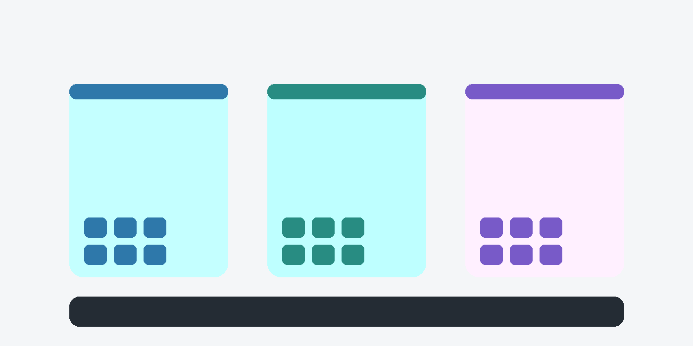

**This is a sample post that only appears in the demo environment.** It shows how a typical post looks with the elements a Markdown file can use. Nothing here is real news.

More than sixty people joined the call from across Sub-Saharan Africa, South Asia and Southeast Asia. Here are the highlights, with links to the recordings and notes.

## Three updates from the pillars {kicker="Highlights"}

Each pillar shared where it is and what's next:

1. **FHIR Foundations** — the Kotlin Multiplatform SDK reached its first preview.
2. **Reference Toolkit** — the OHS Player gained offline sync for the reference app.
3. **AI Commons** — the evals working group agreed its first benchmark scope.

> Building the blocks once means every country can spend its effort on the parts that are truly local.
>
> — A community member, during the Q&A

## What's next {kicker="Get involved"}

- **Working groups.** The AI Commons groups start meeting in November — register your interest on the Community page.
- **Code.** Good first issues are tagged in every repository.
- **Events.** We'll be at the Global Digital Health Forum in Bangkok.

### Watch the recording



Questions? Drop them in [Discord](https://discord.gg/sfgUU7AHZT) or reply to the newsletter.
